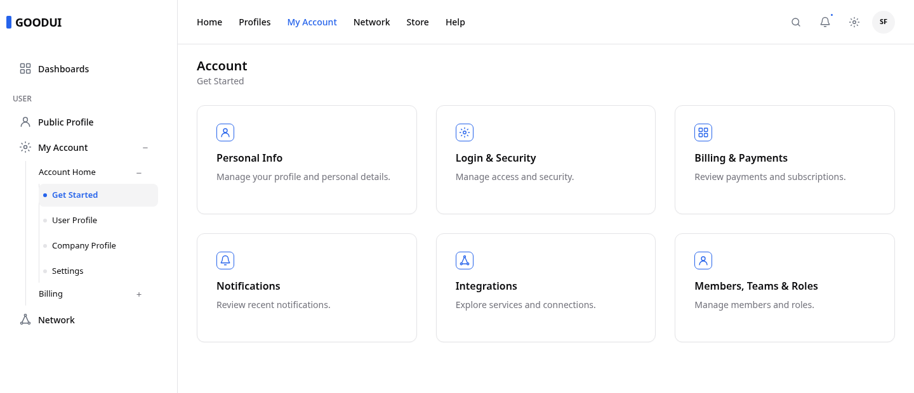

# GoodUI

**A complete Angular application shell, ready for your content.** GoodUI packages a responsive sidebar, topbar, page subnav, buttons, switches, nested menus, search, notifications, settings, avatar menu, and main view as reusable standalone components. The visual system is maintained in Penpot, styled with Tailwind CSS 4, and demonstrated in a real Angular app.

## How to use

GoodUI currently ships from this repository as a locally built package. It targets Angular **21.2** and uses Angular Router. You do not need to install Tailwind in your app just to use the compiled GoodUI styles. The single global CSS import loads GoodUI's theme and shell rules; the library does not apply Tailwind's global Preflight reset to your app.

1. Clone and build the library next to your Angular project:

   ```bash
   git clone https://github.com/cloudfrogger/goodui.git
   cd goodui
   npm --prefix angular ci --legacy-peer-deps
   npm run build:lib
   ```

2. Install the built package in your Angular project (adjust the relative path):

   ```bash
   cd ../my-angular-app
   npm install ../goodui/angular/dist/goodui
   ```

3. Import its stylesheet in your application's global `src/styles.css`:

   ```css
   @import "@goodui/angular/styles.css";
   ```

4. Wrap your routes in the shell. GoodUI positions the sidebar, topbar, mobile drawer, and page area; you supply navigation and page content:

   ```ts
   import { Component } from '@angular/core';
   import { RouterOutlet } from '@angular/router';
   import { GoodAppLayoutComponent, type GoodSidebarSection } from '@goodui/angular';

   @Component({
     selector: 'app-root',
     standalone: true,
     imports: [GoodAppLayoutComponent, RouterOutlet],
     template: `
       <good-app-layout brand="MY APP" [sidebarSections]="navigation">
         <router-outlet />
       </good-app-layout>
     `,
   })
   export class App {
     readonly navigation: readonly GoodSidebarSection[] = [
       { id: 'main', heading: 'WORKSPACE', items: [
         { id: 'home', label: 'Home', icon: 'home', route: '/' },
       ] },
     ];
   }
   ```

   Configure your app with `provideRouter(routes)`. Each routed page can use `<good-main-view title="Home">...</good-main-view>` for consistent page spacing. See the [working demo](demo1/src/app/app.ts) and [AppLayout guide](doc/docs/layout/app-layout.md) for topbar items, user data, and nested menus.

   Add actions with `<good-button variant="default">Save</good-button>`. GoodUI includes Lucide Angular as a dependency and re-exports its icon classes, so `<good-button [icon]="plusIcon">Add</good-button>` needs only `LucidePlus` imported from `@goodui/angular`. See the [Button guide](doc/docs/components/button.md) and the demo's `/components/buttons` page for all variants and sizes.

   For on/off settings, use `<good-switch label="Email notifications" [showLabel]="true" [(checked)]="emailEnabled" />`. It also works with Angular forms. See the [Switch guide](doc/docs/components/switch.md) and the demo's `/components/switches` page.

   Your app owns its branding. To use a logo, place its images in your app's `public/` directory and set `brandLogoSrc` and optional `brandLogoDarkSrc` on `<good-app-layout>`. Set `brand` to the accessible name. To set a favicon, place your icon in `public/` and reference it from your app's `src/index.html`; GoodUI never changes the document favicon. See the [AppLayout guide](doc/docs/layout/app-layout.md).

## Current demo



The screenshot shows the current `demo1` application at 1440 × 620 px in light mode. Run the demo to try the menus, responsive drawer, and dark mode.

## What is inside

| Package | Responsibility |
| --- | --- |
| `good-app-layout` | Responsive shell, sidebar and topbar placement, mobile drawer |
| Sidebar components | Sections, headings, items, and recursive submenus |
| Topbar components | Optional brand icon, menu groups, nested dropdowns |
| Main menu components | Search, notifications, settings, and avatar actions |
| `good-main-view` | Page heading, description, actions, and content spacing |
| `good-subnav` | Single-row page navigation with mobile horizontal scroll and child menus |
| `good-button` | Five visual variants, three sizes, optional Lucide icon, and accessible icon-only actions |
| `good-switch` | Accessible on/off control with three sizes, forms support, and theme-aware error styling |
| `good-action-menu` | Compact icon trigger and keyboard-accessible action menu |
| `GoodThemeService` | Light/dark appearance with semantic CSS variables |

The components own their layout. Your app can provide data through `GoodAppLayoutComponent` inputs or compose the exported container and item components directly when needed.

## Run the demo and docs

Requires Node.js 20.19 or newer. From the repository root:

```bash
npm run setup
npm run start:demo
```

Open `http://localhost:4200/`. To run the documentation separately, use `npm --prefix doc start` and open `http://localhost:3000/`. After changing library source, run `npm run build:lib` again. The demo links to the built package at `angular/dist/goodui`.

## Project map

- [Design contract](design.md) — measurements, component ownership, tokens, and Penpot IDs.
- [Button variant registry](design/button-variants.json) — one-to-one Penpot IDs and Angular inputs for all 45 combinations.
- [Token workflow](design-tokens/README.md) — Penpot export, CSS generation, and theme mapping.
- [Documentation](doc/docs/intro.md) — integration, layouts, components, and examples.
- [Angular library](angular/projects/goodui/) — source for `@goodui/angular`.
- [Demo application](demo1/) — an Angular app consuming the built package.
- [Contributor instructions](AGENTS.md) — design and implementation workflow.

GoodUI is under active development. The package has not been published to npm; install the built package from this repository as shown above.

## License

GoodUI is released under the [MIT License](LICENSE). Copyright © 2026 Cloudfrogger, Inc.
