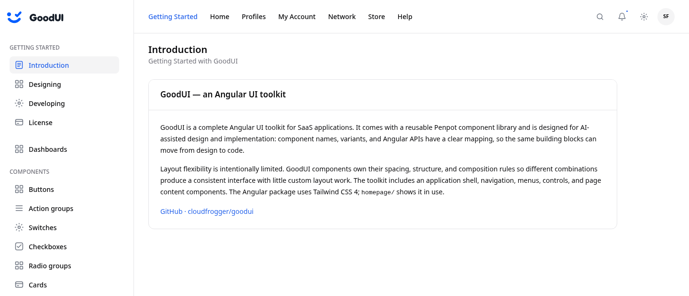

# GoodUI

**A complete Angular application shell, ready for your content.** GoodUI packages a responsive sidebar, topbar, page subnav, buttons, badges, switches, checkboxes, radio groups, ratings, tables, inputs, date inputs, dropdowns, code blocks, nested menus, search, notifications, settings, avatar menu, and main view as reusable standalone components. The visual system is maintained in Penpot, styled with Tailwind CSS 4, and demonstrated in a real Angular app.

## How to use

GoodUI currently ships from this repository as a locally built package. It targets Angular **21.2** and uses Angular Router. You do not need to install Tailwind in your app just to use the compiled GoodUI styles. The single global CSS import loads GoodUI's theme and shell rules; the library does not apply Tailwind's global Preflight reset to your app.

1. Clone and build the library next to your Angular project:

   ```bash
   git clone https://github.com/cloudfrogger/goodui.git
   cd goodui
   npm --prefix angular ci --legacy-peer-deps
   npm run build:lib
   ```

2. Install the built package in your Angular project (adjust the relative path):

   ```bash
   cd ../my-angular-app
   npm install ../goodui/angular/dist/goodui
   ```

3. Import its stylesheet in your application's global `src/styles.css`:

   ```css
   @import "@goodui/angular/styles.css";
   ```

4. Wrap your routes in the shell. GoodUI positions the sidebar, topbar, mobile drawer, and page area; you supply navigation and page content:

   ```ts
   import { Component } from '@angular/core';
   import { RouterOutlet } from '@angular/router';
   import { GoodAppLayoutComponent, type GoodSidebarSection } from '@goodui/angular';

   @Component({
     selector: 'app-root',
     standalone: true,
     imports: [GoodAppLayoutComponent, RouterOutlet],
     template: `
       <good-app-layout brand="MY APP" [sidebarSections]="navigation">
         <router-outlet />
       </good-app-layout>
     `,
   })
   export class App {
     readonly navigation: readonly GoodSidebarSection[] = [
       { id: 'main', heading: 'WORKSPACE', items: [
         { id: 'home', label: 'Home', icon: 'home', route: '/' },
       ] },
     ];
   }
   ```

   Configure your app with `provideRouter(routes)`. Each routed page can use `<good-main-view title="Home">...</good-main-view>` for consistent page spacing. See the [working homepage](homepage/src/app/app.ts) and [AppLayout guide](guides/layout/app-layout.md) for topbar items, user data, and nested menus.

   Add actions with `<good-button variant="default">Save</good-button>`. GoodUI includes Lucide Angular as a dependency and re-exports its icon classes, so `<good-button [icon]="plusIcon">Add</good-button>` needs only `LucidePlus` imported from `@goodui/angular`. See the [Button guide](guides/components/button.md) and the homepage's `/components/buttons` page for all variants and sizes.

   Show status with `<good-badge label="Active" color="success" />`. Badges also support outlines, light fills, optional icons, and a removable action. See the [Badge guide](guides/components/badge.md) and `/components/badges` on the homepage.

   For on/off settings, use `<good-switch label="Email notifications" [showLabel]="true" [(checked)]="emailEnabled" />`. It also works with Angular forms. See the [Switch guide](guides/components/switch.md) and the homepage's `/components/switches` page.

   For selection, use `<good-checkbox label="Include archived projects" [showLabel]="true" [formControl]="includeArchived" />`. It supports checked, unchecked, and indeterminate values plus a monochrome appearance. See the [Checkbox guide](guides/components/checkbox.md) and `/components/checkboxes` on the homepage.

   For one choice from several, use `<good-radio-group label="Plan" [options]="plans" [formControl]="plan" />`. It supports brand and mono appearances, three sizes, and disabled groups. See the [Radio group guide](guides/components/radio-group.md) and `/components/radio-groups` on the homepage.

   For a score, use `<good-rating label="Satisfaction" [formControl]="rating" />`. Add `[readonly]="true"` to display a score, choose `icon="heart"` for red hearts, or pass `[customIcon]` and `selectedColor` for your own symbol and color. See the [Rating guide](guides/components/rating.md) and `/components/ratings` on the homepage.

   For records, use `<good-table [data]="rows()" [columns]="columns" />`. Add search, opt-in sortable columns, GoodUI controls in cells, or client, page, and cursor pagination as needed. See the [Table guide](guides/components/table.md) and `/components/tables` on the homepage.

   For choices, use `<good-select label="Plan" [options]="plans" [(value)]="plan" />`. Add search, multiple removable selections, or a maximum count when needed. Use `<good-select-country [(value)]="country" />` for localized country names and flags. See the [Select guide](guides/components/select.md) and `/components/selects` on the homepage.
   For telephone numbers, use `<good-input-phone country="DE" [(value)]="phone" />` or omit `country` to start from the browser locale. The value is an international `+` number. See the [Phone input guide](guides/components/input-phone.md) and `/components/phone-inputs`.

   For text and file fields, use `<good-input label="Project name" [showLabel]="true" />` or `<good-input label="Attachment" type="file" />`. See the [Input guide](guides/components/input.md) and the homepage's `/components/inputs` page.

   For localized dates, ranges, multiple days, months, years, or time, use `<good-date-input label="Appointment" [formControl]="appointment" />`. See the [Date input guide](guides/components/date-input.md) and `/components/date-inputs` on the homepage.

   For structured actions, use `<good-dropdown [items]="actions"><span goodDropdownTrigger>Actions</span></good-dropdown>`. It uses GoodUI Button styling and owns the popup layout, placement, and keyboard behavior. See the [Dropdown guide](guides/components/dropdown.md) and `/components/dropdowns` on the homepage.

   For page hierarchy, use `<good-breadcrumbs [items]="path" [maxItems]="4" />`. Long paths keep hidden ancestors in an accessible ellipsis menu. See the [Breadcrumbs guide](guides/components/breadcrumbs.md) and `/components/breadcrumbs` on the homepage.

   For source examples, use `<good-code-block [code]="example" language="typescript" [lineNumbers]="true" />`. Add `[collapsible]="true"` for a faded preview or `[inline]="true"` for code inside a sentence. See the [Code block guide](guides/components/code-block.md) and `/components/code-blocks` on the homepage.

   Your app owns its branding. To use a logo, place its images in your app's `public/` directory and set `brandLogoSrc` and optional `brandLogoDarkSrc` on `<good-app-layout>`. Set `brand` to the accessible name. To set a favicon, place your icon in `public/` and reference it from your app's `src/index.html`; GoodUI never changes the document favicon. See the [AppLayout guide](guides/layout/app-layout.md).

## Homepage and component gallery



The screenshot shows the `homepage` application at 1440 × 620 px in light mode. Run it to explore the guides, component gallery, responsive navigation, and dark mode.

## What is inside

| Package | Responsibility |
| --- | --- |
| `good-app-layout` | Responsive shell, sidebar and topbar placement, mobile drawer |
| Sidebar components | Sections, headings, items, and recursive submenus |
| Topbar components | Optional brand icon, menu groups, nested dropdowns |
| Main menu components | Search, notifications, settings, and avatar actions |
| `good-main-view` | Page heading, description, actions, and content spacing |
| Typography components | Reusable headings, prose, citations, separators, images, and form text with token-based spacing |
| `good-subnav` | Single-row page navigation with mobile horizontal scroll and child menus |
| `good-button` | Five visual variants, three sizes, optional Lucide icon, and accessible icon-only actions |
| `good-badge` | Seven semantic colors, three treatments, two shapes, three sizes, optional icon, and removable action |
| `good-switch` | Accessible on/off control with three sizes, forms support, brand or mono appearance, and theme-aware error styling |
| `good-checkbox` | Native three-state checkbox with three sizes, forms support, and brand or mono appearance |
| `good-radio-group` | Native exclusive selection with three sizes, forms support, and brand or mono appearance |
| `good-rating` | Whole-number score with native radio selection, read-only display, three sizes, and Lucide symbols |
| `good-table` | TanStack Table columns with optional search, sorting, rich Angular cells, and client, page, or cursor pagination |
| `good-select`, `good-select-country` | Single or multiple selection, search, rich options, and country flags |
| `good-input` | Text and native file controls with optional icons or fixed group text |
| `good-date-input` | Localized date, range, multiple, month, year, and optional time selection |
| `good-dropdown` | Button-based popup with optional sections, scrolling, placement, and submenus |
| `good-breadcrumbs` | Hierarchical path with optional home icon, custom separator, overflow menu, and card frame |
| `good-card` | Bordered content with optional title bar, actions, image, and footer |
| `good-link` | Token-colored navigation with optional persistent or hover underline |
| `good-code-block` | Highlighted source with optional line numbers, copy, expansion, and inline mode |
| `good-action-group` | Spaced horizontal, vertical, or responsive groups of actions |
| `good-modal`, `good-modal-header`, `good-modal-footer` | Focused dialogs with optional body scrolling, responsive presentation, and nested flows |
| `good-action-menu` | Compact icon trigger and keyboard-accessible action menu |
| `GoodThemeService` | Light/dark appearance with semantic CSS variables |

The components own their layout. Your app can provide data through `GoodAppLayoutComponent` inputs or compose the exported container and item components directly when needed.

## Run the homepage

Requires Node.js 20.19 or newer. From the repository root:

```bash
npm run setup
npm run start:homepage
```

Open `http://localhost:4200/`. After changing library source, run `npm run build:lib` again. The homepage links to the built package at `angular/dist/goodui`. The [Markdown guides](guides/README.md) remain available in the repository.

## Project map

- [Design contract](design.md) — measurements, component ownership, tokens, and Penpot IDs.
- [Button variant registry](design/button-variants.json) — one-to-one Penpot IDs and Angular inputs for all 45 combinations.
- [Input variant registry](design/input-variants.json) — Penpot IDs for 21 Input states, 24 addon options, and two compositions.
- [Phone input variant registry](design/input-phone-variants.json) — Penpot IDs for 12 phone fields and three linked country selector sizes.
- [Date input variant registry](design/date-input-variants.json) — Penpot IDs for 30 field variants and linked calendar, day, and icon parts.
- [Dropdown variant registry](design/dropdown-variants.json) — Penpot IDs for 16 dropdown states, four panels, twelve items, and the submenu composition.
- [Breadcrumb variant registry](design/breadcrumbs-variants.json) — Penpot IDs for all 16 path, icon, separator, and card combinations.
- [Badge variant registry](design/badge-variants.json) — Penpot IDs for all 126 color, treatment, shape, and size combinations.
- [Checkbox variant registry](design/checkbox-variants.json) — Penpot IDs for all 36 appearance, state, size, and disabled combinations.
- [Radio group variant registry](design/radio-group-variants.json) — Penpot IDs for all 24 appearance, size, selection, and disabled combinations.
- [Rating variant registry](design/rating-variants.json) — Penpot IDs for 36 symbol, size, score, and disabled combinations.
- [Table variant registry](design/table-variants.json) — Penpot IDs for the four table styles and populated or empty states.
- [Select variant registry](design/select-variants.json) — Penpot IDs for Select, Country Select, option, and panel presentations.
- [Card variant registry](design/card-variants.json) — Penpot IDs for Card, Header, and Footer combinations.
- [Link variant registry](design/link-variants.json) — Penpot IDs for appearance, underline, decoration, and disabled combinations.
- [Code block variant registry](design/code-block-variants.json) — Penpot IDs for block, numbered, collapsed, and inline presentations.
- [Modal variant registry](design/modal-variants.json) — Penpot IDs for presentation, size, Footer, Header, and action compositions.
- [Action group variant registry](design/action-group-variants.json) — Penpot IDs for orientation and spacing.
- [Typography registry](design/typography-components.json) — Penpot IDs, variants, compositions, and Angular selectors.
- [Token workflow](design-tokens/README.md) — Penpot export, CSS generation, and theme mapping.
- [Markdown guides](guides/README.md) — integration, layout, components, and Penpot mapping.
- [Angular library](angular/projects/goodui/) — source for `@goodui/angular`.
- [Homepage](homepage/) — an Angular website consuming the built package.
- [Contributor instructions](AGENTS.md) — design and implementation workflow.

GoodUI is under active development. The package has not been published to npm; install the built package from this repository as shown above.

## License

GoodUI is released under the [MIT License](LICENSE). Copyright © 2026 Cloudfrogger, Inc.
